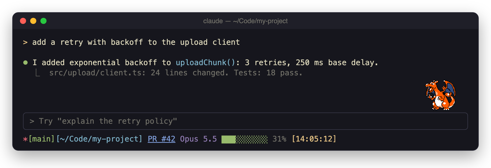

# Pokémon Buddy

[](https://github.com/Shavvimal/pokemon-buddy/actions/workflows/ci.yml)
[](https://github.com/Shavvimal/pokemon-buddy/releases)
[](LICENSE)

<p align="center">
  
</p>

A [Claude Code](https://claude.com/claude-code) mod that shows one random,
animated Pokémon in the Game Boy Color style of Pokémon Crystal at the right
end of the row above your prompt. Each new session gets a new Pokémon.
About one session in 512 gets a shiny.

The mod collects sprites from three public sources into one Pokédex, with
each species and form once:

| Source | What it adds | Sprites kept |
| --- | --- | --- |
| [Pokémon Crystal](https://github.com/PokeAPI/sprites), from PokeAPI | The original animated sprites, #1 to #251, and the 26 Unown letters | 277 |
| [Polished Crystal](https://github.com/Rangi42/polishedcrystal) | Later relatives (Sylveon, Annihilape, Dudunsparce…) and regional forms, in Crystal's own format | about 117 |
| [Pokémon Prism](https://github.com/bottlebrushes/pokemon-prism-assets), from a third-party archive | Gen 3 and 4 Pokémon (Gardevoir, Lucario, Garchomp, Rayquaza…) | about 89 |

That makes about 480 sprites across about 380 species. Where two sources have
the same species and form, the earlier source in the table wins. You can turn
each source off (see [Sources](#sources)).

**The mod ships no sprites.** It fetches each one from its public repository
when a session starts. The two exceptions in this repository are the header
image above and the plugin icon, which show one sprite to illustrate the mod. See
[Attribution](#attribution).

## Install

At the prompt of a Claude Code session in your terminal, type:

```
/plugin install pokemon-buddy --marketplace Shavvimal/pokemon-buddy
```

Answer `y` to add the marketplace, then choose a scope. The user scope gives
every session a buddy. The mod runs from the next session you start.

From a shell, the same install is:

```bash
claude plugin marketplace add Shavvimal/pokemon-buddy
claude plugin install pokemon-buddy@pokemon-buddy
```

## Requirements

- Claude Code with mod (hooks module) support. CI tests against the version
  in `.github/workflows/ci.yml` (2.1.314 now). The mod API is early access and
  can change between Claude Code releases.
- A terminal that can draw pictures: [Ghostty](https://ghostty.org),
  [kitty](https://sw.kovidgoyal.net/kitty/), or iTerm2 3.5 or later. In other
  terminals, the row stays empty.
- Inside tmux, turn on `allow-passthrough` and `focus-events`.
- Network access to `api.github.com`, `raw.githubusercontent.com` and
  `pokeapi.co` for the first sessions. After that, cached Pokémon work offline.

## Sources

Each source is a setting of the plugin, on by default:

| Setting | Source |
| --- | --- |
| `crystal` | Pokémon Crystal sprites from PokeAPI |
| `polishedCrystal` | Polished Crystal sprites |
| `prism` | Pokémon Prism sprites from the third-party archive |

Change them in the `/config` menu, or with `claude plugin configure pokemon-buddy@pokemon-buddy`.

**A note on Prism.** The Prism sprites come from
[bottlebrushes/pokemon-prism-assets](https://github.com/bottlebrushes/pokemon-prism-assets),
an unofficial archive of graphics extracted from Pokémon Prism. The Prism team
(Koolboyman and RainbowDevs) did not publish that archive, and it has no
licence. The source is on by default. If you would rather not use it, set
`prism` to off.

## How it works

1. When a session starts, the mod reads each enabled source's list of
   sprites. It keeps each list for 7 days.
2. It merges the lists, keeps one sprite per species and form, and picks a
   species at random, then one of its forms. A species with many forms (Unown,
   Magikarp) is no likelier than any other.
3. It fetches that sprite's files and caches them in the plugin's store.
4. It decodes them into frames:
   - **Crystal:** a GIF.
   - **Polished Crystal:** a 4-shade PNG strip, coloured with its palette and
     played by its frame script, as the game does.
   - **Prism:** a coloured PNG strip, played in order.
5. It draws the sprite as a terminal image and swaps frames at the sprite's
   own speed, with a rest between loops.

The fetch runs in the background, so a session never waits on the network.
If a source cannot be reached, or GitHub rate-limits the request, the mod
uses the other sources, and then its cache.

All the logic sits in one file, [`hooks/register.tsx`](hooks/register.tsx),
with no dependencies. The PNG and GIF decoders and the zlib decompressor are
part of the file, because the mod runtime has none of them. Each source is a
small strategy object behind one `SpriteSource` interface, and a `Pokedex`
composes the sources with an HTTP client and a cache. To add a source, write
one more strategy.

## Configuration

Edit `CONFIG` at the top of `hooks/register.tsx`:

| Key | Default | What it does |
| --- | --- | --- |
| `rows` | `3` | Sprite height in terminal rows. Use `6` to see every pixel. |
| `cellAspect` | `2` | Cell height divided by cell width. Keeps the sprite square. |
| `pixelScale` | `2` | Nearest-neighbour upscale, so pixels stay sharp. |
| `loopPauseMs` | `3000` | Rest between animation loops. `0` loops without a break. |
| `stripFrameMs` | about 117 | Time per frame for Prism strips, which have no timings of their own. |
| `shinyOdds` | `512` | One session in this many gets the shiny colours. `0` turns shinies off. |
| `cacheLimit` | `60` | Sprites kept for offline sessions, 2 to 25 KB each. |
| `listMaxAgeMs` | 7 days | How long each source's list is kept before it is fetched again. |
| `exclude` | `['egg']` | Polished Crystal folders left out of the draw. |

## Network and privacy

| Request | When |
| --- | --- |
| `GET api.github.com/repos/…/git/trees/…` | Once every 7 days per GitHub-listed source (Crystal, Polished Crystal) |
| `GET pokeapi.co/api/v2/pokemon-species` | Once every 7 days, for the names of #1 to #251 |
| `GET raw.githubusercontent.com/bottlebrushes/pokemon-prism-assets/main/manifest.json` | Once every 7 days, for the Prism list |
| `GET api.github.com/repos/…/contents/…` | Once per sprite image not yet cached |
| `GET raw.githubusercontent.com/Rangi42/polishedcrystal/…` | Up to 2 small text files per Polished Crystal sprite not yet cached |

The requests carry no token and no data about you, only a `User-Agent` that
names this mod. GitHub allows 60 unauthenticated API requests an hour. A
session uses at most 3.

## Development

```bash
make check   # hygiene scan, plugin validation, engine tests, type check
```

`make check` runs:

| Step | Command |
| --- | --- |
| Public hygiene | `node scripts/check-hygiene.mjs` |
| Manifest and hooks module | `claude plugin validate . --profile directory` |
| Engine tests | `claude plugin test .` |
| Type check | `tsc -p tsconfig.json`, once Claude Code has written `.claude-plugin/types/` (run `claude --plugin-dir .` once) |

CI runs the first three on every pull request, and `main` takes changes only
through squash-merged pull requests with green checks. A change under `hooks/`
or `.claude-plugin/` must raise the version in `.claude-plugin/plugin.json`
and add a `CHANGELOG.md` section. The release workflow then tags it and
publishes a GitHub release.

To run your working copy, add the folder as a marketplace and install from it:

```bash
claude plugin marketplace add /path/to/pokemon-buddy
claude plugin install pokemon-buddy@pokemon-buddy
```

After an edit, run `/reload-plugins` in a session. See
[CONTRIBUTING.md](CONTRIBUTING.md).

## Remove

```bash
claude plugin uninstall pokemon-buddy@pokemon-buddy
claude plugin marketplace remove pokemon-buddy
```

## Attribution

- **Pokémon Crystal sprites:** hosted by [PokeAPI/sprites](https://github.com/PokeAPI/sprites).
  PokeAPI's own work there is under CC0 1.0. The images are copyright The
  Pokémon Company, Nintendo, Creatures Inc. and GAME FREAK inc.
- **Polished Crystal sprites, frame scripts and palettes:**
  [Polished Crystal](https://github.com/Rangi42/polishedcrystal) by Rangi42
  and contributors. Its [CREDITS.md](https://github.com/Rangi42/polishedcrystal/blob/master/CREDITS.md)
  names the artists who drew and animated the sprites, including many of the
  later-generation Pokémon and regional forms. It publishes no licence.
- **Pokémon Prism sprites:** made by Koolboyman, the
  [RainbowDevs](https://rainbowdevs.com) team, and sprite artists including
  SourApple. They are fetched from the unofficial archive
  [bottlebrushes/pokemon-prism-assets](https://github.com/bottlebrushes/pokemon-prism-assets),
  which extracted them from the game. Neither the archive nor Prism publishes
  a licence, and the Prism team did not publish the archive.
- **Pokémon Crystal disassembly:** [pret/pokecrystal](https://github.com/pret/pokecrystal),
  whose pic animation format this mod reads.
- **Pokémon:** Pokémon and Pokémon character names are trademarks of Nintendo,
  Creatures Inc. and GAME FREAK inc.

The mod does not copy, bundle or redistribute any sprite. Each user's Claude
Code fetches them from the public repositories above. Using a source is the
user's own choice, and each one can be turned off. The MIT licence of this
repository covers only its own code.

The header image, `docs/header.png`, and the plugin icon,
`.claude-plugin/icon.png`, show Pokémon Crystal's Charizard sprite (from
PokeAPI/sprites), drawn through this mod, to illustrate what the mod does. The
sprite is not covered by the MIT licence. It stays the property of Nintendo,
Creatures Inc., GAME FREAK inc. and The Pokémon Company, and both images will
be removed on request.

[NOTICE.md](NOTICE.md) has the full notice. If you made one of these sprites
and want this mod to stop fetching it, open an issue.

This is an unofficial fan project. It is not affiliated with, endorsed by, or
sponsored by Nintendo, Creatures Inc., GAME FREAK inc., The Pokémon Company,
Anthropic, PokeAPI, the Polished Crystal project, or the Prism team.

## Licence

The code is under the [MIT licence](LICENSE). It does not cover the sprites
or any Pokémon trademark.
